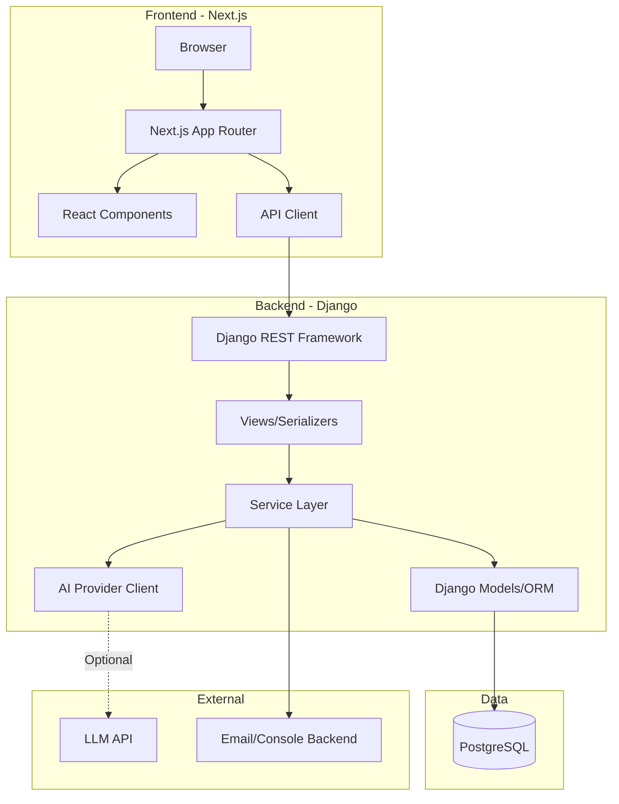
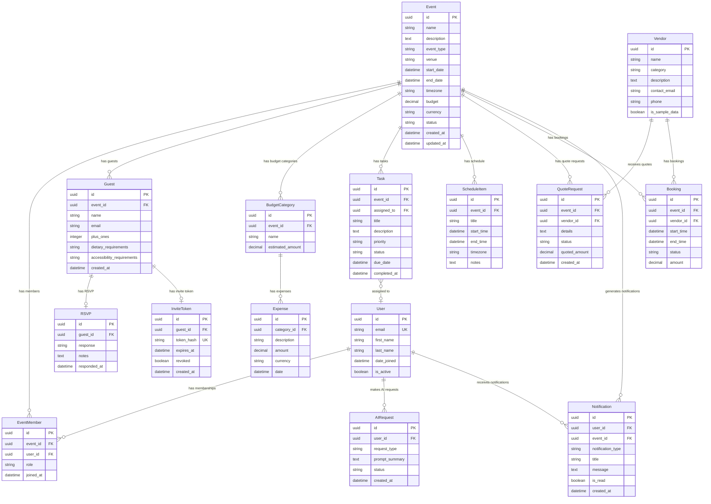

# Festora Architecture Overview

## System Architecture

## Design Principles

1. **Thin views, thick services**: Business logic lives in `services.py` modules, not in views or serializers.
2. **Object-level permissions**: Every event-scoped endpoint checks membership. No data accessible by guessing IDs.
3. **Server-side validation**: All validation happens on the backend. Frontend validation is for UX only.
4. **Explicit state machines**: Event and booking lifecycles have defined transitions enforced server-side.
5. **Decimal-safe money**: All monetary values use `DecimalField` with explicit precision.
6. **UUID identifiers**: Primary keys use UUIDs to prevent enumeration attacks.
7. **Secure by default**: Production settings enforce HTTPS, secure cookies, CSP, HSTS.

## Data Model

## Key Constraints and Invariants

1. **EventMember uniqueness**: `UNIQUE(event_id, user_id)` — a user can only have one role per event.
2. **RSVP uniqueness**: One RSVP per guest (`OneToOneField`).
3. **Invite token security**: Tokens are hashed with SHA-256 before storage. `UNIQUE(token_hash)`.
4. **Money precision**: All monetary fields use `DecimalField(max_digits=12, decimal_places=2)`.
5. **Non-negative amounts**: Database `CHECK` constraints on monetary fields.
6. **Event status transitions**: Enforced via service layer state machine (draft→planning→confirmed→completed; any→cancelled).
7. **Booking overlap prevention**: PostgreSQL exclusion constraint on `(vendor_id, tstzrange(start_time, end_time))` for active bookings.
8. **Currency consistency**: Mixed-currency calculations are rejected.
9. **Token expiry**: Tokens expire after 7 days by default. Expired/revoked tokens are rejected.

## API Design

All endpoints are under `/api/` prefix:

| Prefix | App | Description |
|--------|-----|-------------|
| `/api/auth/` | accounts | Authentication |
| `/api/events/` | events | Event CRUD and lifecycle |
| `/api/events/{id}/guests/` | guests | Guest management |
| `/api/events/{id}/rsvp/` | guests | RSVP via invite token |
| `/api/events/{id}/budget/` | budget | Budget categories and expenses |
| `/api/events/{id}/tasks/` | tasks | Task management |
| `/api/events/{id}/schedule/` | tasks | Schedule items |
| `/api/vendors/` | vendors | Vendor directory |
| `/api/events/{id}/quotes/` | vendors | Quote requests |
| `/api/events/{id}/bookings/` | vendors | Bookings |
| `/api/ai/` | ai | AI assistant |
| `/api/notifications/` | notifications | User notifications |
| `/api/health/` | core | Health check |

## Security Architecture

See [Threat Model](threat-model.md) for detailed analysis.

Key security controls:
- Session-based authentication with secure cookies
- Object-level authorization on all event-scoped endpoints
- CSRF protection for state-changing requests
- Rate limiting on authentication and public endpoints
- Input validation at serializer and service layers
- PostgreSQL parameterized queries (via Django ORM)
- No secrets in version control
- Generic error responses (no stack traces in production)
